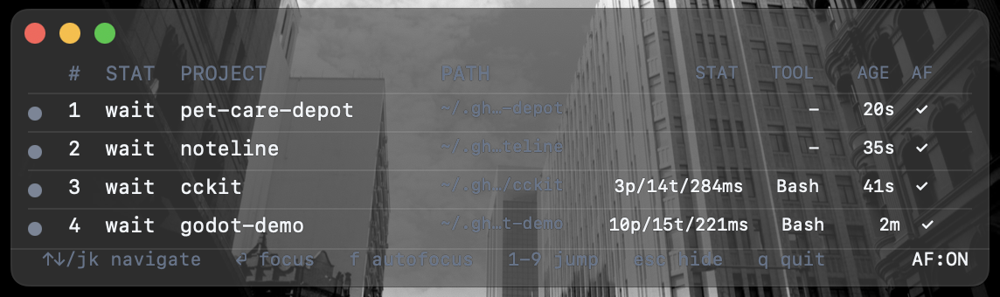

# cckit

> Ever lost track of where you launched Claude Code?
> "Which project did I install that MCP server in again?"

If you run Claude Code across many projects, you've probably faced these issues. cckit helps you stay organized.

Claude Code Kit - A toolkit for managing Claude Code and OpenAI Codex environments. Provides session monitoring, project inspection, and cleanup tools.

## Overview

cckit helps you manage and monitor your AI coding tool sessions:

- **Session Monitoring** (`session`) - Track active Claude Code, Codex, Antigravity and Grok sessions in real-time in a macOS window app
- **Session Search** (`session search`) - Search past Claude Code sessions by message text
- **Session Bookmarks** (`session bookmark`) - Bookmark sessions with a name and tags so you can find them again later
- **Multi-tool Support** - Works with Claude Code, OpenAI Codex, Antigravity (`agy`) and Grok via hooks
- **Project Inspection** (`ls`) - View all Claude Code projects with their skills, agents, commands, plugins, and MCP servers at a glance
- **Skill/MCP/Agent Management** (`skill`, `mcp`, `agent`) - List, copy, promote, validate, and remove skills, MCP servers, and agents across projects
- **Permissions Audit** (`permissions`) - List, audit, and clean risky allow/deny rules across all projects
- **Environment Cleanup** (`tidy-up`, `prune`, `sync`) - Analyze for cleanup opportunities and remove stale data
- **Marketplace Inspection** (`marketplace`) - Inspect and validate custom plugin marketplace directories

## Install

```bash
cargo install --git https://github.com/tmtk75/cckit
```

Or from local source:

```bash
cargo install --path .
```

## Commands

```bash
cckit session      # Manage Claude Code sessions (opens the window app)
cckit ls           # List Claude Code projects
cckit skill        # Manage skills across projects (ls, copy, promote, validate, how-to-remove)
cckit mcp          # Manage MCP servers across projects (ls, copy, how-to-remove)
cckit agent        # Manage agents across projects (ls, how-to-remove)
cckit permissions  # List/audit permissions across all projects
cckit tidy-up      # Analyze skills, MCP servers, and plugins for cleanup opportunities
cckit marketplace  # Inspect and validate a custom plugin marketplace
cckit config       # Show ~/.claude.json contents in a readable format
cckit prune        # Remove non-existent paths from ~/.claude.json
cckit notify       # Send macOS notification (macOS only)
cckit status       # Show cckit status and file paths
cckit doctor       # Check cckit configuration health
```

### Short forms

The commands typed daily carry a one- or two-letter alias, listed by `--help` as
`[aliases: ...]`:

```bash
cckit s b s -c "something"   # = cckit session bookmark set --current "something"
cckit s r                    # = cckit session recent
cckit s s auth               # = cckit session search auth
cckit sk l                   # = cckit skill ls
```

`ls` is `l` wherever a command lists things. `session` is `s`, `skill` is `sk`, `mcp` is
`mc`, `monitor` is `mon`, `agent` is `a`, `marketplace` is `mk`. Under `session`: `l`, `s`
(search), `r` (recent), `b` (bookmark); under `bookmark`: `s` (set), `l`, `i` (id), `t`
(tag). `bookmark ls --group-by tag` is `cckit s b l -g t` (`-g p` for path). `install`, `uninstall`, `hook`, `sync` and `focus` keep their full names on purpose,
so a slip of the finger cannot rewrite a hook configuration.

## session Command

Track active Claude Code sessions in real-time via hooks.

### Why?

When running Claude Code across multiple projects, it's hard to track which sessions are active and which are waiting for input. You might not notice a background agent is still running and end up waiting for nothing.

The `session` command shows all session states at a glance, so you always know "what's running where" instantly.

> **Tip:** Especially useful with tmux — when you spot a session waiting for input, you can instantly switch to that pane/window.

### Setup

Install hooks to enable session tracking:

```bash
# For Claude Code (writes to ~/.claude/settings.json)
cckit session install

# For OpenAI Codex (writes to ~/.codex/hooks.json + enables feature flag)
# Requires codex-cli >= 0.117.0
cckit session install --codex

# For Antigravity (writes to ~/.gemini/config/hooks.json)
cckit session install --agy

# Grok needs no install: it reads ~/.claude/settings.json via its Claude Code
# compatibility mode, so the first command above already covers it.
```

### Usage

```bash
# Open the session window app (macOS, same as `cckit app`)
cckit session

# Print active sessions as text
cckit session ls
```

Status markers in the text list:

- `●` - Running (processing)
- `◐` - Awaiting approval
- `○` - Waiting for user input
- `×` - Session ended

See [Mac App](#mac-app-macos) for the window.

### Hook Management

```bash
# Install hooks for Claude Code
cckit session install

# Install hooks for OpenAI Codex
cckit session install --codex

# Install hooks for Antigravity
cckit session install --agy

# Show hook configuration status
cckit session status

# Remove hooks
cckit session uninstall          # Claude Code
cckit session uninstall --codex  # Codex
cckit session uninstall --agy    # Antigravity

# Clean up stale sessions
cckit session sync --execute
```

#### Grok (`grok`)

**Nothing to install.** Grok reads the hooks in `~/.claude/settings.json` through its
Claude Code compatibility mode, so `cckit session install` already covers it. Grok
sessions appear alongside the others as soon as they start.

Grok sends every field twice, once in camelCase and once in snake_case
(`sessionId` and `session_id`, `transcriptPath` and `transcript_path`, and so on), and
`hook_event_name` carries Claude's own event names, so cckit dispatches on it unchanged.
The one key with no snake_case twin is `hookEventName`, which holds grok's own spelling
(`"pre_tool_use"`); that is what cckit uses to tell a Grok session from a Claude Code one,
since both arrive through the same hooks.

The payload carries no model id, but grok records one per session in
`summary.json`, next to the transcript the payload points at. cckit reads it there on
every event, so the MODEL column shows `Grok 4.7` and follows a mid-session model switch.
The context gauge stays empty: grok's transcript does not carry the token counts cckit
reads.

If you would rather keep Grok's hooks separate from Claude Code's, drop a file in
`~/.grok/hooks/` and turn the compatibility scan off with `[compat.claude] hooks = false`
in `~/.grok/config.toml`. cckit does not need this.

#### Antigravity (`agy`)

Antigravity's hooks differ from the other two, so cckit tracks a little less there.

**A session appears on its first prompt, not when `agy` starts.** Antigravity has no
`SessionStart` event, and every hook cckit installs fires at or after the first model
call. Launching `agy` and leaving it at the prompt shows nothing; type something and the
session appears as `● run`, then settles to `○ wait`.

**No `PreToolUse` hook is installed.** That event's contract requires the hook to answer
with a permission decision (`allow` / `deny` / `ask` / `force_ask`), and a hook that says
nothing is taken as a refusal. A session monitor must not answer that question: granting
would rubber-stamp every tool call, refusing would block them all. Tool calls are
therefore recorded by `PostToolUse`, after they have run, and the "awaiting approval"
state does not appear for Antigravity sessions.

Antigravity also calls the model repeatedly within one turn, so the prompt count is taken
from the invocations that follow a `Stop` rather than from every invocation. The context
gauge stays empty: Antigravity's transcripts do not carry the token usage cckit reads.

Hooks are written to `~/.gemini/config/hooks.json` under the name `cckit`, leaving any
other named hooks in that file untouched. A `.agents/hooks.json` inside a project is not
read by the CLI, which is why the global file is the one cckit writes.

### Session Search

Search past Claude Code sessions by message text:

```bash
# Search by keywords (AND match)
cckit session search terraform plan

# JSON output
cckit session search --json deploy

# Limit results
cckit session search --limit 5 refactor

# Report no matches instead of falling back to fuzzy
cckit session search --exact terraform plan
```

When the keyword search finds nothing, the same query is retried fuzzily so a typo still
reaches the session, and the output says so:

```
No exact match for "skll stale". Showing fuzzy matches.
```

The fallback only runs when the exact search came up empty, so a query that matches keeps
behaving exactly as before. `--exact` turns the fallback off. With `--json` the notice goes
to stderr, leaving stdout a bare JSON array.

### Session Bookmarks

A session id tells you nothing three weeks later. Find the session, bookmark it with a
name and some tags, and it stays findable:

```bash
# 1. Find it
cckit session search terraform plan

# 2. Bookmark it by id (a leading fragment is enough)
cckit session bookmark set 7568e813 "auth refactor" --tag auth --tag infra

# Or bookmark the session running in this terminal
cckit session bookmark set --current "auth refactor" --tag auth

# List what you have bookmarked, newest first
cckit session bookmark ls
cckit session bookmark ls --tag auth
cckit session bookmark ls --here            # only what ran in this directory or below
cckit session bookmark ls --group-by path   # bucket by directory (short: -g p)
cckit session bookmark ls --group-by tag    # bucket by tag (short: -g t)
cckit session bookmark ls --json

# Add or remove tags later, without retyping the name
cckit session bookmark tag 7568e813 urgent
cckit session bookmark tag 7568e813 --rm infra

# Print just the id, for use in another command
cckit session bookmark id auth

# Put one out of sight without deleting it, and bring it back
cckit session bookmark hide 7568e813
cckit session bookmark ls --all             # hidden ones too, marked (hidden)
cckit session bookmark unhide 7568e813

# Forget one
cckit session bookmark rm 7568e813
```

`hide` is the reversible `rm`: the bookmark stays in the file but drops out of `ls`, `id`,
and the bookmark shown by `session recent` and `session search`. `ls` says how many it left
out, so a hidden bookmark never looks deleted, and `set` on a hidden one makes it visible
again.

`bookmark id` exists for the case this whole feature is aimed at: you start a session
loosely with `claude -w`, decide it deserves a proper workspace, and want to pick it up
there.

```bash
# In the session you started loosely, mark it (! runs a shell command from inside Claude Code)
!cckit session bookmark set --current "auth refactor"

# Later, in a worktree of its own
claude -w feat/auth --resume $(cckit session bookmark id auth)
```

The query matches a bookmark name, then a tag, then a leading fragment of a session id,
and the first net that catches anything decides. Only the id goes to stdout, so it
substitutes cleanly. Several matches print the candidates on stderr and exit 2 rather
than guessing: a `$(...)` that quietly resumes the wrong session is worse than one that
fails.

`set` replaces everything it is given, which is why `tag` exists: adding one tag through
`set` would mean retyping the name and every tag already there, and forgetting one would
drop it silently. `tag` leaves the name alone and reports tags that were already set (or
were not there to remove), so a typo does not pass for success.

`bookmark ls` ends with where the file lives, so "nothing bookmarked yet" is never
confused with "cckit is reading a different file than you think":

```
4 bookmarks in ~/Library/Application Support/cckit/bookmarks.json
```

`--here` keeps the sessions that ran in the current directory **or below it**, so a repo
root finds work started deep inside it. Paths are compared segment by segment, so a
worktree sitting next to the repo (`proj-wt` beside `proj`) is not swept in.

`--group-by tag` lists a bookmark under **every** tag it carries, rather than picking one.
Collapsing it would mean searching `#design` and not finding something tagged `#design`.
Untagged bookmarks collect under `(no tag)` at the end, and the footer counts rows rather
than bookmarks, since one bookmark with two tags is two rows.

```
$ cckit session bookmark ls --group-by tag
#jch
  2026-09-25 17:12    3d ago  jch-338. TLS version #jch #tls  066f035c-…  ~/src/team-server-jp/…

#tls
  2026-09-25 17:12    3d ago  jch-338. TLS version #jch #tls  066f035c-…  ~/src/team-server-jp/…
```

The first column is when the bookmark was last edited; the second is how long ago the
session itself was last talked to, read from the last turn in its transcript (`-` when
no transcript is found, as for a Codex thread). `--json` carries it as `last_active_at`.
On a color terminal the age is shaded by recency so the live ones jump out: under 2h
bright green, under 8h green, under 24h yellow, under 3d plain, under 7d dim, older grey.

Under `--group-by path` the row stops at the session id, because the heading already
names the directory. `--json` stays flat whatever the grouping, so `jq` consumers do not
have to follow a shape that changes with a display flag.

Overwriting an existing bookmark says what it replaced, so a `--current` that landed on
the wrong terminal is visible rather than silent:

```
$ cckit session bookmark set --current "BCPの改善"
renamed 7568e813-… from "auth refactor #auth" to "BCPの改善"
```

Bookmarks are stored in `bookmarks.json` beside `sessions.json`, so they outlive the
session they name. `bookmark ls` reads only that file plus the tail of each bookmarked
session's transcript for the age column, so it answers instantly even with thousands of
transcripts on disk.

Bookmarked sessions are marked with `★` in `session recent`, and `session search` matches
names and tags as well as message text:

```
$ cckit session search auth
2026-09-24 06:30  ~/src/app (main)
  session: 7568e813-f23e-466a-96f5-ee06bb8f6955  turns: 42  matches: bookmark
  bookmark: auth refactor #auth #infra
```

Bookmarks are keyed by session id, so a session resumed with `--resume` (which starts a new
id) does not inherit the name of the one it continues.

## ls Command

List Claude Code projects with their skills, agents, commands, and MCP servers.

### Why?

As your skills, agents, and MCP servers grow, it becomes hard to remember "what's configured where." Global settings (`~/.claude/`) mix with project-specific ones, and you might accidentally duplicate skills across projects.

The `ls` command displays all project configurations in one view. Quickly answer questions like "Which project has that Notion MCP server?" or "Where did I put that terraform skill?"

```bash
# Show projects with content
cckit ls

# Show all projects
cckit ls --all

# Filter by path pattern
cckit ls --path-filter tmtk75

# Filter by MCP server name
cckit ls --mcp-filter notion

# Filter by skill name
cckit ls --skill-filter terraform

# Show duplicate projects (same git remote)
cckit ls --duplicates

# Hide specific content types
cckit ls --no-skills --no-agents --no-mcp --no-commands
```

### Output Example

```
63 projects (12 with content)

~/.claude (global)
  Skills:
    - managing-terraform-safely - This skill should be used when the user asks to "run terr...
    - developing-python - This skill should be used when the user asks to "create p...
  Agents:
    - root-cause-analyzer - Use this agent when you need systematic investigation and...

~/projects/example-project
  Skills:
    - testing - This skill should be used when the user asks to "write te...
  MCP Servers:
    - notion (http) from ~/.ghq/github.com/example/project/.mcp.json
    - serena (stdio) - uvx serena start-mcp-server from ~/.ghq/github.com/example/project/.mcp.json
```

## skill Command

Manage skills across all projects. List, copy between projects, promote to global scope, and validate for security.

```bash
# List all skills with their origin (personal, marketplace, plugin, etc.)
cckit skill ls

# Filter by name
cckit skill ls -f terraform

# Show skills in a specific project
cckit skill ls .

# Show only duplicates
cckit skill ls --dupes

# Copy a skill from another project
cckit skill copy --from ~/other-project -n my-skill

# Promote a project skill to user scope (~/.claude/skills/)
cckit skill promote -n my-skill

# Show how to remove/uninstall each skill
cckit skill how-to-remove

# Validate skills for security concerns (embedded shell commands, etc.)
cckit skill validate                              # All installed skills
cckit skill validate https://github.com/user/repo # GitHub URL
cckit skill validate ./path/to/skill/             # Local path
```

## mcp Command

Manage MCP servers across all projects.

```bash
# List all MCP servers with their origin
cckit mcp ls

# Filter by name
cckit mcp ls -f notion

# Copy an MCP server config from another project
cckit mcp copy --from ~/other-project -n my-server

# Show how to remove/uninstall each MCP server
cckit mcp how-to-remove
```

## agent Command

Manage agents across all projects.

```bash
# List all agents with their origin
cckit agent ls

# Filter by name
cckit agent ls -f root-cause

# Show how to remove/uninstall each agent
cckit agent how-to-remove
```

## tidy-up Command

Analyze skills, MCP servers, and plugins for cleanup opportunities.

```bash
# Full analysis
cckit tidy-up

# Skills only
cckit tidy-up --skills-only

# MCP servers only
cckit tidy-up --mcp-only

# Show context budget summary only
cckit tidy-up --budget-only
```

## marketplace Command

Inspect and validate a custom plugin marketplace directory.

```bash
# Show all plugins, skills, hooks, and MCP servers
cckit marketplace summary ./my-marketplace

# Validate structure and consistency
cckit marketplace doctor ./my-marketplace
```

## config Command

Show `~/.claude.json` contents in a readable format.

```bash
# Show overview
cckit config

# Inspect a specific key
cckit config projects

# Raw JSON output
cckit config --raw
```

## notify Command

Send macOS notifications (macOS only).

### Why?

During long-running tasks (large refactors, test suites, etc.), you might switch to other work and miss when Claude Code finishes.

The `notify` command pairs with Claude Code's Stop hook to send desktop notifications when sessions end. Never miss a task completion again—get notified and take action immediately.

### Setup with Stop Hook

Add to `~/.claude/settings.json`:

```json
{
  "hooks": {
    "Stop": [
      {
        "matcher": "",
        "hooks": [
          {
            "type": "command",
            "command": "cckit notify"
          }
        ]
      }
    ]
  }
}
```

When a session ends, `cckit notify` receives session details via stdin and displays a notification with the stop reason.

### Usage

```bash
# Simple notification
cckit notify -m "Build complete"

# With title and subtitle
cckit notify -t "CCKit" -s "Build" -m "Success!"

# With sound
cckit notify -m "Done" --sound Ping

# Custom position and duration
cckit notify -m "Alert" --position center-top --duration 10000

# Read message from stdin
echo "Task finished" | cckit notify
```

Options:
- `-t, --title` - Notification title (default: "cckit")
- `-s, --subtitle` - Subtitle
- `-m, --message` - Message body
- `--sound` - Sound name (e.g., "Ping", "Purr", "default")
- `-d, --duration` - Display duration in ms (default: 3000)
- `-p, --position` - Window position: right-top, center-top, left-top, etc.
- `--opacity` - Window opacity 0.0-1.0
- `--bgcolor` - Background color as hex

## permissions Command

List and audit `permissions.allow` / `permissions.deny` from settings files across all projects.

### Why?

Claude Code's allow rules accumulate over time across `~/.claude/settings.json` and each project's `.claude/settings.json` / `.claude/settings.local.json`. Some allowed patterns are dangerously broad (e.g., `Bash(python:*)`, `Bash(rm:*)`, `Bash(git push:*)`), but it's hard to spot them when scattered across dozens of projects.

The `permissions` command gives you a single view of all permission rules, with an audit mode that flags risky patterns and a clean mode to remove them.

```bash
# List all permissions across all projects
cckit permissions

# Filter by pattern
cckit permissions -f 'uv run'

# Audit: show only risky allow patterns with reasons
cckit permissions --audit

# Clean: dry-run showing what would be removed
cckit permissions --audit --clean

# Clean: actually remove risky entries
cckit permissions --audit --clean --execute

# Combine filter with clean
cckit permissions --audit --clean --execute -f 'Bash(rm'
```

### Risky Patterns Detected

| Category | Patterns | Risk |
|---|---|---|
| Arbitrary code execution | `python:*`, `python3:*`, `node:*`, `source:*` | Can run any code |
| File destruction | `rm:*` | Can delete any file |
| Git destructive ops | `git push:*`, `git reset:*`, `git checkout:*` | Can destroy history or discard changes |
| Overly broad wildcards | `gh:*`, `terraform:*`, `pnpm:*` | Includes destructive subcommands |
| Deny bypass | `cat:*` | Can read files blocked by Read deny rules |
| Infrastructure | `aws ...`, `AWS_PROFILE=...` | Cloud resource access |
| External messaging | `slack_send_message` | Can send messages on your behalf |

## prune Command

Remove non-existent project paths from `~/.claude.json`.

### Why?

When you delete or move projects, their paths remain in `~/.claude.json`. Over time, this clutter can slow down Claude Code startup and make `cckit ls` output noisy.

The `prune` command detects and removes non-existent paths, keeping your configuration clean.

```bash
# Dry-run (shows what would be removed)
cckit prune

# Actually remove paths
cckit prune --execute
```

## status Command

Show cckit status and file paths.

### Why?

When troubleshooting or setting up cckit, you need to know where configuration and data files are located, and whether they exist.

The `status` command displays all relevant file paths with their existence status, size, and last modified time.

```bash
cckit status
```

Output:
```
cckit Status

Claude Code Files:
  ~/.claude.json              exists (125266 bytes, modified: 2026-02-02 20:18:53)
  ~/.claude/settings.json     exists (3660 bytes, modified: 2026-02-01 22:47:44)

cckit Data Files:
  sessions.json               exists (530 bytes, modified: 2026-02-02 20:50:54)
    Path: ~/Library/Application Support/cckit/sessions.json

Session Summary:
  Total sessions: 1
  Active: 1
```

## doctor Command

Check cckit configuration health.

### Why?

After installation or when things aren't working, you need to verify that cckit is properly configured with the necessary hooks in Claude Code settings.

The `doctor` command checks your configuration and reports any issues or missing setup.

```bash
cckit doctor
```

Checks:
- `~/.claude/settings.json` exists
- PostToolUse hook for session tracking is configured
- Stop hook for notifications is configured (optional)
- Data directory exists

## Configuration

cckit reads `config.toml` from the current directory, `~/.config/cckit/config.toml`, or the
platform config directory (first one found wins; they are not merged).

```toml
# Paths to skip when scanning projects (ls, skill, mcp, ...).
# A pattern with `*` or `?` is a glob, otherwise it matches as a prefix. A leading `~/` expands.
disable_paths = [
    "/path/to/ignore",
    "/path/with/glob/*",
]

# Skills to hide from `cckit skill stale`, for skills you knowingly keep around
# but rarely fire. Every entry is a glob, matched against the skill name (the
# directory name and the frontmatter `name`) and against the skill directory
# path. A glob with no wildcards matches exactly, so a bare name works as-is.
# A leading `~/` expands; a pattern that is not absolute matches anywhere in the
# path, so `github.com/acme/**` hides every skill under that org.
skill_stale_exclude = [
    "isms-monthly-audit",
    "slack-*",
    "github.com/acme/**",
]
```

## Mac App (macOS)



CCKit can run as a standalone macOS app with a session window.

### Why?

Keeping a monitor open in the terminal takes up screen space. The Mac App shows a dedicated window: just glance at it to check session status when needed.

Set it to launch at login and always stay aware of your Claude Code activity.

### Build

```bash
# Build the app bundle
mise run build-app  # or: ./scripts/macos/build_app.sh
```

### Usage

Double-click `CCKit.app` or run from terminal:

```bash
# Run as app
cckit app

# From app bundle (auto-detects .app context)
open dist/CCKit.app
```

### Keyboard Shortcuts

| Key | Action |
|-----|--------|
| `↑↓` / `jk` | Navigate sessions |
| `⏎` | Focus selected session's terminal |
| `1-9` | Jump to session by number |
| `f` | Toggle auto-focus for selected project (or all if none selected) |
| `Esc` | Deselect and hide window |
| `Cmd+H` | Hide window |
| `Cmd+Opt+H` | Hide other apps |
| `Cmd+M` | Minimize window |
| `Cmd+Q` | Quit |
| `Cmd+,` | Open config file |
| `Cmd+Shift+,` | Reload config |

## How it works

### session command

1. Uses Claude Code / Codex / Antigravity hooks to track session lifecycle events
2. Stores session data in `~/Library/Application Support/cckit/sessions.json` (macOS)
3. The window app displays active sessions with status, working directory, and last tool info
4. Detects subagent sessions (Claude Code teams/agents) and shows agent names
5. Auto-removes stale sessions when the underlying process exits

### ls command

1. Reads `~/.claude.json` to get registered projects
2. Scans each project's `.claude/` directory for skills, agents, and commands
3. Scans `.mcp.json` for MCP server configurations
4. Parses YAML frontmatter from markdown files
5. Displays name and description for each component

### session search command

1. Scans all Claude Code transcript JSONL files under `~/.claude/projects/`
2. Parses user/assistant turns with timestamps
3. Matches search terms (AND logic) against session text, retrying fuzzily when nothing matches

### skill/mcp/agent commands

1. Scans global (`~/.claude/`) and all project `.claude/` directories
2. Detects origin: personal (skill-creator), marketplace, installed plugin, or project-local
3. `copy` transfers configurations between projects
4. `promote` moves project-local skills to user scope (`~/.claude/skills/`)
5. `validate` checks skills for embedded shell commands and other security concerns

### permissions command

1. Reads `~/.claude/settings.json` (global) and each project's `.claude/settings.json` / `.claude/settings.local.json`
2. Extracts `permissions.allow` and `permissions.deny` arrays
3. In audit mode, matches allow entries against built-in risky patterns (prefix match)
4. In clean mode, removes matched entries from the JSON files
